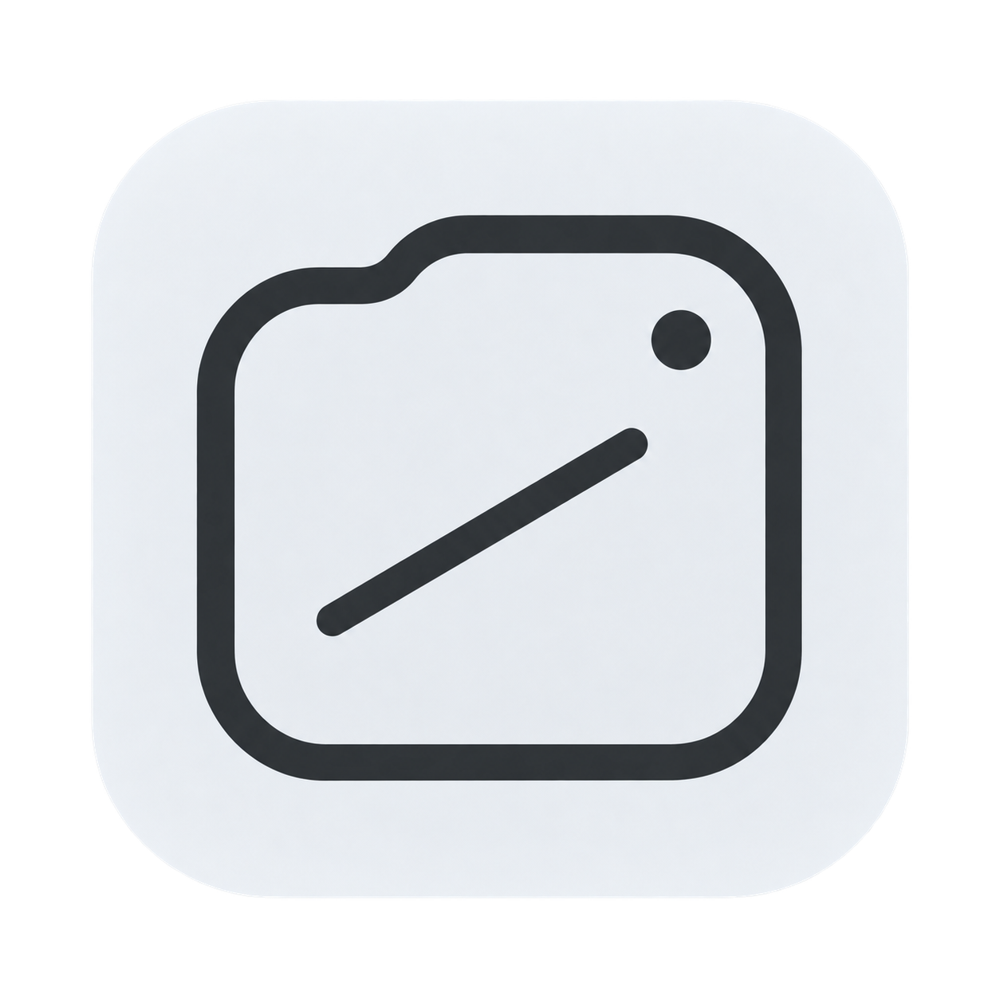
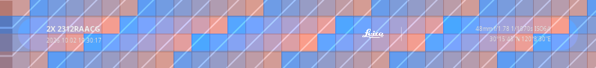
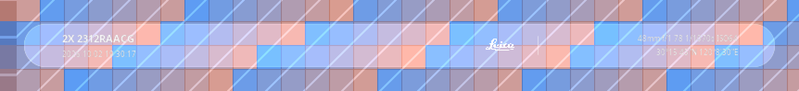
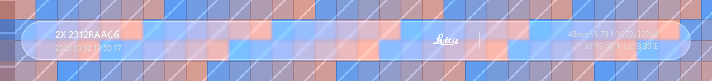
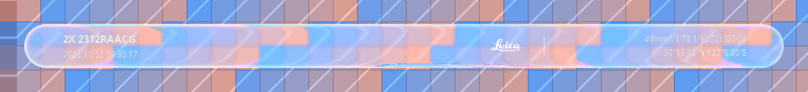

<p align="center">
  
</p>

<h1 align="center">LiquidFrame</h1>

[简体中文](README_CN.md)

LiquidFrame is an LSPosed module that replaces the watermark on supported Xiaomi Camera output paths with a liquid-glass capsule. The repository also includes a standalone app for previewing the material.

This project is not affiliated with or endorsed by Xiaomi, Leica or Apple.

## Features

- Replaces the stock watermark on supported camera paths.
- Reads device, time, exposure and location data from the current capture record. Missing fields are omitted.
- Renders refraction, dispersion, blur and edge effects on the CPU.
- Includes a Compose settings screen and a material gallery app.

## Preview

These images were rendered off-device with `docs/RenderSamples.kt`; they are not camera samples.

| Original panel | Frosted | Liquid glass |
| --- | --- | --- |
|  |  |  |



## Requirements

**Module (`app/`)**

- Android 8.0 (API 26) or later
- Xiaomi Camera, usually `com.android.camera` or `com.miui.camera`
- LSPosed or a framework compatible with Xposed API 82
- Root access

**Gallery (`gallery/`)**

- Android 13 (API 33) or later
- No root or LSPosed required

## Install

1. Install the module APK.
2. Enable LiquidFrame in LSPosed and select the Xiaomi Camera package installed on the device.
3. Force-stop the camera, reopen it and adjust the watermark in the module settings.
4. Take a test photo and confirm that the installed camera version reaches a supported replacement path.

Camera internals vary by release, so compatibility with every camera version is not guaranteed. Disable the module if the camera behaves unexpectedly. Include the camera version and module log when reporting an issue.

## Build

Use JDK 21 and Android SDK Platform 37.

```bash
./gradlew :app:assembleDebug :gallery:assembleDebug
```

APKs are written to `app/build/outputs/apk/` and `gallery/build/outputs/apk/`.

See [SIGNING_SETUP.md](SIGNING_SETUP.md) for release signing.

## Repository

- `app/` — LSPosed module, settings UI and CPU material renderer
- `gallery/` — material gallery and real-time rendering components
- `tools/` — camera APK / DEX analysis and matcher checks
- `docs/` — off-device render samples

## License

Apache License 2.0. Third-party notices are listed in [NOTICE](NOTICE).
