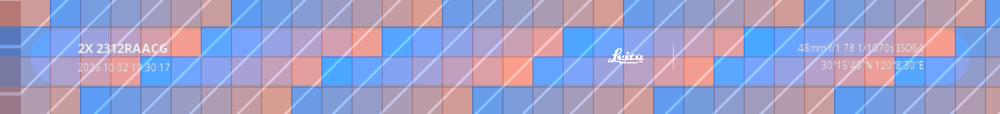
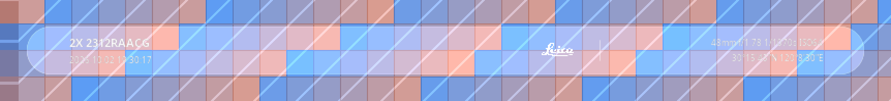
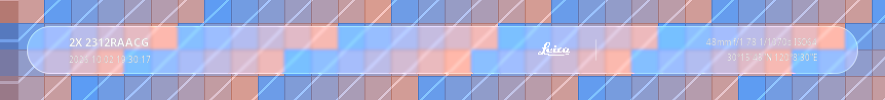
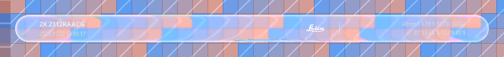

# LiquidFrame

[English](README.md) | [简体中文](README_CN.md)

[](https://www.android.com/)
[](https://github.com/LSPosed/LSPosed)
[](https://kotlinlang.org/)
[](LICENSE)
[](../../actions)

An LSPosed module that replaces the background of Xiaomi Camera's photo watermark with an
Apple-style **Liquid Glass** material, plus a companion HyperOS (miuix) app for designing and
tuning that material.

> This is an independent project. It is not affiliated with, endorsed by, or supported by
> Xiaomi, Leica, or Apple.

---

## Table of contents

- [What it does](#what-it-does)
- [Screenshots](#screenshots)
- [Repository layout](#repository-layout)
- [Requirements](#requirements)
- [Installation](#installation)
- [Configuration](#configuration)
- [The material](#the-material)
  - [How it renders](#how-it-renders)
  - [Why a companion app exists](#why-a-companion-app-exists)
- [How the hook works](#how-the-hook-works)
- [Building](#building)
- [Troubleshooting](#troubleshooting)
- [Limitations and known issues](#limitations-and-known-issues)
- [Credits and licensing](#credits-and-licensing)

---

## What it does

Xiaomi Camera creates a watermark in its photo-output pipeline. LiquidFrame intercepts the verified
watermark Bitmap factory **before the stock watermark is drawn**, then renders a custom liquid-glass
capsule directly onto the clean source photo. It does not paint a guessed rectangle over the finished
JPEG or mistake arbitrary scene pixels for a watermark. In this path the original watermark group
(text and logo included) is replaced as a whole by the new capsule.

"Liquid Glass" here means a surface that does more than blur:

| Property | What it contributes |
| --- | --- |
| **Refraction (lens)** | The backdrop is sampled at an offset that grows toward the silhouette, so the panel bends and magnifies the scene behind it instead of just fogging it. |
| **Chromatic dispersion** | The refraction splits into a seven-tap spectrum, which is antisymmetric across the diagonals — a prism on opposite edges rather than a uniform colour fringe. |
| **Vibrancy** | A saturation lift on the captured backdrop. Real glass concentrates colour; without it the material reads as grey fog next to saturated content. |
| **Specular rim** | A hemispheric normal along the rounded edge, lit from two directions, giving two opposing highlights that rotate with the light. |
| **Inner shadow** | A soft edge-anchoring shade, so the panel reads as a solid object rather than a sticker. |

The current hook targets MIUI Camera `1+6.4.000250.2`; see
[Limitations](#limitations-and-known-issues) for the exact supported path and open gaps.

## Screenshots

The companion app renders the material over a deliberately hostile backdrop — saturated colour
fields with hard edges and fine grain — so the lens, dispersion and rim are judged against content
that has structure to bend. The images below are off-device material demonstrations comparing the
baseline, frosting and refraction. They are not camera captures from the new watermark hook.

| Baseline (panel as drawn) | Frosted (blur + tint, no lens) | Liquid glass (adds lens) |
| --- | --- | --- |
|  |  |  |

High-dispersion close-up — the spectral split is antisymmetric across the diagonals, so it reads
as a prism on opposite edges rather than a uniform colour fringe:



> These are renders from the material's own optics, generated off-device by
> `docs/RenderSamples.kt` over a synthetic scene (`./gradlew`-independent, run with the standalone
> Kotlin compiler — see `docs/renders.txt`). They are the reference the implementation is checked
> against, not device captures.

## Repository layout

```
app/                    LSPosed module (the watermark hook)
  src/main/java/com/mouya/LiquidFrame/
    WatermarkHooks.kt     hook installation and the composite pipeline
    DexKitHelper.kt       legacy discovery component (not started by the current exact hook path)
    ConfigStore.kt        settings shared between the module and the camera process
    GlassConfig.kt        the camera-side view of those settings
    ConfigActivity.kt     settings UI: Compose + iOS-style glass, live preview
    dex/DexScanner.kt     legacy dependency-free DEX reader; current hook uses verified signatures
    glass/                the optics engine (no Android dependency)
      LiquidGlassOptics.kt  CPU port of the material
      GlassParams.kt        every quantity in the material
      PanelScan.kt          locating the watermark panel from pixels
gallery/                HyperOS (miuix) app: the material as live components
  src/main/java/com/mouya/LiquidFrame/gallery/
    GlassNavigationBar / LiquidBackdrop / GalleryApp
    glass/                the real-time (GPU) material
      Lens.kt               AGSL rounded-rect refraction lens
      Glass.kt              GlassSpec and Modifier.liquidGlass
    screens/              material, controls and overlays pages
docs/                   reference renders
```

## Requirements

**Module (`app/`)**

- Android 8.0+ (API 26). The material runs on the CPU over integer pixel buffers, so it has no
  `RuntimeShader` floor; the settings UI is Jetpack Compose with a hand-drawn glass surface for the
  same reason.
- Xiaomi Camera as `com.android.camera` or `com.miui.camera`.
- LSPosed (or another Xposed API 82+ compatible framework).
- Root, and a writable `/data/local/tmp` — settings and logs live there.

**Companion app (`gallery/`)**

- Android 13+ (API 33). `miuix-blur` hard-codes that floor.
- No root and no LSPosed required; it is an ordinary app.

## Installation

1. Build or download `app-debug.apk`, and install it.
2. Enable the module in LSPosed and set its **scope to the installed Xiaomi Camera package** (`com.android.camera` or `com.miui.camera`).
3. Force-stop Xiaomi Camera, then reopen it.
4. Take a photo with a watermark enabled.

To confirm the current 6.4.000250.2 hook path was installed, check the module log for
`hooked typed capture metadata` and `hooked real watermark output`. After taking a photo, look for
`watermark factory: stock watermark replaced`. Missing metadata fields are intentionally omitted;
they are not filled with guessed values.

## Configuration

Open the module from the launcher. Settings are stored in the app-private files directory
and mirrored to `/data/local/tmp/lf_config.txt` for the camera process. The shared-file write may
need root authorization; the settings page reports whether synchronization actually succeeded. A
successful sync applies to the next capture without restarting the camera.

The settings screen renders a **live preview** with the same optics the module uses, so the
material can be judged and tuned without taking a photo. The controls are:

| Setting | Effect |
| --- | --- |
| Enable | Master switch. |
| Refraction band height | Thickness of the refracting band along the silhouette. Too small reads as a hairline; too large warps the whole panel like a fisheye. |
| Refraction strength | Peak displacement at the silhouette. Useful range is roughly 1–3× the band height. |
| Blur | Frosting of the captured backdrop. Keep it low: heavy blur destroys the detail the lens is supposed to bend. |
| Interior lift | Additive brightness across the panel. This is the readability knob for the new capsule text. |
| Tint | Strength of the tint painted over the refracted backdrop. |
| Rim highlight | Strength of the specular edge. |
| Inner shadow | Edge-anchoring shade. |
| Highlight angle | Direction of the rim light, in degrees. |
| Depth effect | Leans the surface normal toward the centre so the glass reads as a dome. |
| Chromatic aberration | Strength of the spectral split; `0` disables it. |
| Adaptive | Scales tint, veil and rim against the scene's mean luminance. |
| Capture metadata | Rebuilds the capsule from real capture fields; missing fields are omitted. |

"Reset to defaults" restores the shipped values; "Copy log" puts the last run's diagnostics on the
clipboard.

## The material

### How it renders

The optics are a port of the reference renderer used by the miuix ecosystem
(Apache-2.0; attribution and upstream link are recorded in the `NOTICE` file). The same
mathematics exists in two backends, because the two places it must run have different constraints:

- **`app/glass/LiquidGlassOptics.kt`** — a CPU implementation on integer pixel buffers. The
  current hook applies it to a cropped region of the clean source photo inside the camera's
  watermark Bitmap factory, before the stock watermark is drawn. This file has **no Android
  dependency at all**, which is what makes the optics testable off-device.
- **`gallery/glass/Lens.kt`** — an AGSL `RuntimeShader`, applied as a live `RenderEffect` chain
  through miuix's backdrop engine. This is the real-time path used by the companion app.

Both keep the reference's own mathematics rather than an approximation of it:

- the signed distance field and its gradient are the reference's `sdRoundedRect` /
  `gradSdRoundedRect`;
- the displacement profile is `circleMap(1 - -sd / refractionHeight)` — the sagitta of a unit
  circle, not a linear ramp — multiplied by a negative amount so the backdrop is pulled inward and
  the panel magnifies what is behind it;
- the surface normal is `normalize(gradSdRoundedRect(c, halfSize, min(1.5r, minHalf)) + depth * normalize(c))`.
  The `1.5 ×` factor is the reference's own: the upstream commit that introduced it exists solely
  to match Apple's render;
- dispersion is the reference's seven-tap spectrum with its exact channel divisors (`1/3.5`
  dominant, `1/3.0` for pure red and blue, `1/7.0` cross-talk);
- the effect order is the documented one: **colour filter → blur → lens**.

Two things the reference expresses as *drawing operations* are modelled analytically, because a
shader has no stroke or blur-mask to lean on:

- the **rim highlight** is the reference's blurred white stroke, combined with the directional
  weighting of its `Default` highlight shader;
- the **inner shadow** is its recorded layer — the shape filled, the offset shape cleared, then
  blurred.

Default proportions are calibrated against the reference project's own Apple comparison, in which
a 300 px glass uses a 20 px band with a 60 px displacement.

### Why a companion app exists

The material's real-time form cannot be injected into Xiaomi Camera. The inspected camera DEX is a **classic View application with no Compose runtime**: its string
table contains no `androidx/compose` references (only `Lmiux/...` View classes). Hosting a
Compose UI inside the camera process would mean shipping the entire Compose runtime into it.

So the project is split: the module applies the material on the CPU to the source photo Bitmap
inside the camera's capture pipeline, and the companion app hosts it in real time over miuix
components — including a floating bottom navigation bar whose rim visibly bends the content
drifting past behind it.

The companion app builds on [`miuix`](https://github.com/compose-miuix-ui/miuix) (Xiaomi's
open-source design system, Apache-2.0). `miuix-blur` supplies the backdrop engine — graphics-layer
capture, the blur cascade, and the `runtimeShaderEffect` extension point — as well as
`buildBloomStrokeShader`, which is a specular rim model of exactly the kind this material needs.
What miuix deliberately leaves to the application is the **lens**, which is what `gallery/glass/`
provides.

## How the hook works

The current implementation targets the supplied disassembly of **MIUI Camera `1+6.4.000250.2`**
(`versionCode 740002502`). It no longer treats `Fe/a->j(...)` as the finished photo and no longer
walks arbitrary object graphs looking for numbers that happen to resemble EXIF values.

### Real capture metadata

```text
CaptureResult / TotalCaptureResult
        │
        ▼
E5/c.b(CaptureResult) -> la/b
  SENSOR_EXPOSURE_TIME  -> exposure ns
  LENS_APERTURE         -> aperture
  La6/N.b(result)       -> ISO
  La6/O.c(result)       -> 35mm-equivalent focal length
        │
        ▼
E5/c.c(LR9/o)
  combines result + LR9/p.D:Location + LR9/o.I:timestamp(ms)
        │
        ▼
la/a typed capture record
  f:S  focal length (35mm equivalent)
  g:F  aperture
  h:J  exposure time (ns)
  i:I  ISO
  j:J  capture timestamp (ms)
  k:Location GPS
        │
        ▼
E5/b.h(la/a, boolean, int)
  LiquidFrame ThreadLocal snapshot
        │
        ▼
com.xiaomi.cam.watermark.b.c(..., Bitmap srcBitmap, ...): Bitmap
  stock watermark renderer bypassed
        │
        ▼
custom capsule rendered on source photo Bitmap
```

`CaptureMeta` accepts only those typed fields and validates their ranges. Exposure nanoseconds are
converted to seconds; the capture timestamp is interpreted as Unix milliseconds; GPS is accepted
only as a valid `Location`. Missing or invalid values stay absent — no current-time fallback, random
number, frame counter, or arbitrary field scan is used.

### Watermark replacement point

`E5/b.h(la/a, boolean, int)` is the still-photo watermark processing entry point in this build. It
calls `com.xiaomi.cam.watermark.b.b(Application, Bitmap, Dc/b, int)`, a wrapper that calls the static
`com.xiaomi.cam.watermark.b.c(b, Context, Bitmap, Dc/b, int, String, int) -> Bitmap`. That method
creates `com.xiaomi.cam.watermark.c` and enters Xiaomi's original watermark rendering path.

LiquidFrame hooks the exact static `b.c(...)` method, guarded by the active `E5/b.h` ThreadLocal
capture context. Its third argument is the source photo Bitmap. The hook bypasses the stock renderer,
draws the replacement capsule onto the source photo, and returns it. If copying or rendering fails,
it leaves the hook result unset so the original Xiaomi method proceeds (fail-open).

This is not post-processing erasure: the old watermark is not first baked into the JPEG and then
covered by an opaque patch. `Fe/a->j(...)` rasterizes a `Fe/a` watermark layer tree into a Bitmap; in
the relevant `WatermarkRemover.getWatermarkData(...)` flow it can create a blank canvas for the layer,
so it is not a stable handle to the final photograph. Treating that scratch Bitmap as the source photo
was the wrong target.

`WatermarkRemover.getWatermarkData(Bitmap, Fe/a, ...)` returns a `WatermarkRemover$b` structure
(status, rectangle/region and image-byte data), not a Bitmap. It is used for watermark-region
identification/movement and must not be treated as the final photo or as a replaceable Bitmap.

### Scope

- Hook compatibility depends on this build's obfuscated names and signatures: `E5.b#h(la.a,
  boolean, int)` and `com.xiaomi.cam.watermark.b#c(...)`. Nearby version numbers do not prove
  compatibility; re-check the target APK.
- This hook covers the `E5/b.h` Bitmap watermark path. HEIF/MIVI3 or other direct metadata/byte-stream
  paths may bypass this Bitmap factory and are not claimed as supported here.
- The original watermark is replaced as a whole, including its text and logo. The new capsule is
  rebuilt from available capture metadata and the module's optional logo assets.
- Runtime behaviour still needs device validation: confirm the hook is called by the desired mode
  and compare the displayed fields against the saved photo's EXIF.

## Building

Requirements: JDK 21 and an Android SDK with platform `android-37` installed.

```bash
./gradlew assembleDebug
```

Artifacts:

```
app/build/outputs/apk/debug/app-debug.apk          # the LSPosed module
gallery/build/outputs/apk/debug/gallery-debug.apk  # the companion app
```

Toolchain: Android Gradle Plugin **9.4.1**, Kotlin **2.4.20**, Gradle **9.8.0**. The
`miuix 0.9.4 / Compose 1.12` dependency chain refuses to be consumed by older tooling (their AAR
metadata rejects it), which is why these floors are where they are. AGP 9 supplies Kotlin itself,
so `org.jetbrains.kotlin.android` is deliberately not applied; the Compose compiler is applied
separately via `org.jetbrains.kotlin.plugin.compose`.

CI builds `:app` only. `gallery/` needs `compileSdk 37`, so it is built locally, not on every push.

## Troubleshooting

**The original watermark is still present.** Check that the LSPosed scope includes the actual camera
package (`com.android.camera` or `com.miui.camera`), force-stop and reopen the camera, and look for
`hooked typed capture metadata` plus `hooked real watermark output` in the module log.

**No `watermark factory` log appears.** The selected capture mode may not use the `E5/b.h` Bitmap
watermark path, or the camera method signature may have changed. Verify the camera build and provide
the full module log.

**A metadata field is missing.** This is deliberate fail-closed behaviour: a field is omitted unless
it came from the current capture record. Compare the capsule with the saved photo's EXIF and note the
capture mode, file format (JPEG/HEIF), and camera version.

**The photo looks wrong or capture slows down.** Turn off the module master switch to restore the
stock camera path, then report the original photo, module log, and camera version. Use the original
photo file rather than a screenshot for pixel-level diagnosis.

## Limitations and known issues

- **Implemented against one disassembled build:** MIUI Camera `1+6.4.000250.2`
  (`versionCode 740002502`). Obfuscation/signature changes can make the hook miss.
- **Bitmap watermark path first.** HEIF/MIVI3, RAW, or any other route that bypasses
  `E5/b.h -> watermark/b.c` is not yet covered; watermark replacement is not guaranteed there.
- **No Android build or device test was possible in this environment.** Building requires JDK 21,
  Gradle 9.8.0, AGP 9.4.1 and Android SDK platform 37. The SDK is absent here and the Gradle Wrapper
  download failed because network access was unavailable. This delivery is a static source repair;
  build locally or in CI before installation.
- **The original watermark is replaced as a whole.** Its text and logo are not preserved; the new
  capsule displays fields available in the current capture record.
- **Some capture fields may be unavailable.** Camera2 capabilities, shooting mode, or Xiaomi's
  internal adapter may omit a CaptureResult field. The module omits it instead of inventing a value.
- **Root and LSPosed are required.** The modification operates inside the camera process.

## Credits and licensing

- All third-party attributions, licenses and upstream links are collected in the `NOTICE` file.
  The liquid glass optics are adapted from an Apache-2.0 reference renderer (see `NOTICE`). The
  reference's shader source, constants and the `1.5 ×` gradient factor are used as-is; the CPU
  port and the analytic rim/inner-shadow models are this project's.
- The companion app is built on
  [compose-miuix-ui/miuix](https://github.com/compose-miuix-ui/miuix) (Apache-2.0), Xiaomi's
  design system. Its blur engine supplies the backdrop capture and the specular rim model.
- The `lens()` and `vibrancy()` effects adapted into `gallery/glass/` follow miuix's own example
  implementations (`example/shared/.../component/liquid/`), which are themselves Apache-2.0.

All adapted files point at the `NOTICE` file, which carries the full upstream attributions
and licenses. This project is licensed under the Apache License, Version 2.0 — see [LICENSE](LICENSE).