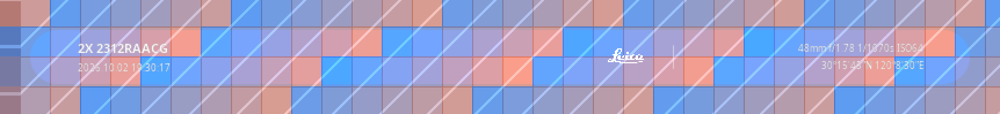
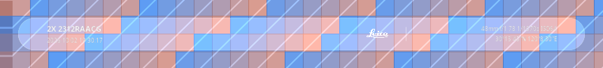
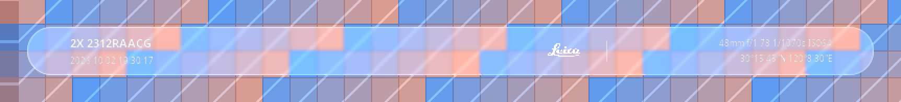
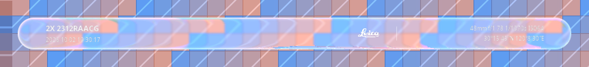

# LiquidFrame

[English](README.md) | [简体中文](README_CN.md)

[](https://www.android.com/)
[](https://github.com/LSPosed/LSPosed)
[](https://kotlinlang.org/)
[](LICENSE)
[](../../actions)

LSPosed 模块：将小米相机照片水印的背景替换为 Apple 风格**液态玻璃**材质，附带 HyperOS（miuix）应用用于设计与调校该材质

> 独立项目，与小米、徕卡、Apple 无任何关联、背书或支持

---

## 目录

- [功能](#功能)
- [截图](#截图)
- [仓库结构](#仓库结构)
- [环境要求](#环境要求)
- [安装](#安装)
- [配置](#配置)
- [材质](#材质)
  - [渲染方式](#渲染方式)
  - [为何需要伴生应用](#为何需要伴生应用)
- [Hook 原理](#hook-原理)
- [构建](#构建)
- [故障排查](#故障排查)
- [限制与已知问题](#限制与已知问题)
- [致谢与许可](#致谢与许可)

---

## 功能

小米相机会在照片输出链路中生成水印。LiquidFrame 在已确认的照片水印 Bitmap 工厂处拦截原相机渲染，并在**原水印绘制前**把自定义液态玻璃胶囊直接绘制到干净照片上。这样不会在成片上用纯色块覆盖旧水印，也不会把普通场景像素误判成水印区域。当前实现会整体替换该路径中的原水印（包括原文字与 Logo），再按设置绘制新胶囊。

这里的"液态玻璃"指不止于模糊的表面：

| 属性 | 贡献 |
| --- | --- |
| **折射（透镜）** | 背景采样偏移向轮廓方向递增，面板弯曲并放大其后场景，而非单纯雾化 |
| **色散** | 折射分裂为七采样光谱，沿对角线反对称——对边上呈棱镜效果，而非均匀色边 |
| **鲜活度** | 对捕获背景做饱和度提升。真实玻璃会聚拢色彩；缺失时材质在饱和内容旁读作灰色雾霭 |
| **镜面边缘** | 圆角边缘的半球法线，双向受光，产生随光线旋转的两个对向高光 |
| **内阴影** | 柔和的贴边阴影，使面板读作实体而非贴纸 |

当前 Hook 以 MIUI Camera `1+6.4.000250.2` 为目标；兼容范围与未覆盖路径见[限制](#限制与已知问题)

## 截图

伴生应用将材质渲染在刻意严苛的背景上——饱和色块、硬边、细颗粒——使透镜、色散与边缘高光对着有结构可弯曲的内容受检。下图是材质算法的离设备示意渲染，用于比较面板基线、磨砂和折射效果；不是本次水印 Hook 的实机输出截图。

| 基线（面板原样） | 磨砂（模糊 + 着色，无透镜） | 液态玻璃（加入透镜） |
| --- | --- | --- |
|  |  |  |

高色散特写——光谱分裂沿对角线反对称，对边上读作棱镜而非均匀色边：



> 这些是材质自身光学的渲染图，由 `docs/RenderSamples.kt` 在合成场景上离设备生成（不依赖 `./gradlew`，用独立 Kotlin 编译器运行——见 `docs/renders.txt`）。它们是实现的对照基准，非设备截图

## 仓库结构

```
app/                    LSPosed 模块（水印 Hook）
  src/main/java/com/mouya/LiquidFrame/
    WatermarkHooks.kt     Hook 安装与合成管线
    DexKitHelper.kt       旧版动态发现组件（当前精确 Hook 路径不启动它）
    ConfigStore.kt        模块与相机进程共享的设置
    GlassConfig.kt        相机侧的设置视图
    ConfigActivity.kt     设置 UI：Compose + 玻璃质感，实时预览
    dex/DexScanner.kt     旧版无依赖 DEX 读取器；当前构建按已验证签名安装 Hook
    glass/                光学引擎（无 Android 依赖）
      LiquidGlassOptics.kt  材质的 CPU 移植
      GlassParams.kt        材质中的每个量
      PanelScan.kt          从像素定位水印面板
gallery/                HyperOS（miuix）应用：实时组件形态的材质
  src/main/java/com/mouya/LiquidFrame/gallery/
    GlassNavigationBar / LiquidBackdrop / GalleryApp
    glass/                实时（GPU）材质
      Lens.kt               AGSL 圆角矩形折射透镜
      Glass.kt              GlassSpec 与 Modifier.liquidGlass
    screens/              材质、控件与浮层页面
docs/                   参考渲染图
```

## 环境要求

**模块（`app/`）**

- Android 8.0+（API 26）。材质在 CPU 上对整数像素缓冲运行，无 `RuntimeShader` 门槛；设置 UI 出于同样理由使用 Jetpack Compose 与手绘玻璃表面
- 小米相机 `com.android.camera` 或 `com.miui.camera`
- LSPosed（或其他 Xposed API 82+ 兼容框架）
- Root 与可写的 `/data/local/tmp`——设置与日志存于此

**伴生应用（`gallery/`）**

- Android 13+（API 33）。`miuix-blur` 硬性要求此门槛
- 无需 Root 与 LSPosed，普通应用

## 安装

1. 构建或下载 `app-debug.apk` 并安装
2. 在 LSPosed 中启用模块，**作用域设为设备实际安装的小米相机包名**（`com.android.camera` 或 `com.miui.camera`）
3. 强停小米相机后重开
4. 开启水印拍照

确认 Hook 已安装：查看模块日志是否出现 `hooked typed capture metadata` 与 `hooked real watermark output`。完成一张拍摄后，若出现 `watermark factory: stock watermark replaced`，表示本次命中了替换路径。缺失的拍摄字段会留空，不再用猜测值补齐。

## 配置

从桌面打开模块。设置先保存在应用私有目录，并镜像同步到相机进程可读取的 `/data/local/tmp/lf_config.txt`。共享文件写入可能需要 Root 授权；设置页会显示实际同步状态。成功同步后，下一次拍摄即可应用，无需重启相机。

设置页用与模块相同的光学渲染**实时预览**，无需拍照即可评判与调校材质。控件：

| 设置 | 效果 |
| --- | --- |
| 启用 | 总开关 |
| 折射带高度 | 沿轮廓的折射带厚度。过小读作发丝线；过大把整个面板扭曲成鱼眼 |
| 折射强度 | 轮廓处的峰值位移。有效范围约为折射带高度的 1–3 倍 |
| 背景模糊 | 捕获背景的磨砂。保持低值：重模糊会摧毁透镜本要弯曲的细节 |
| 内部提亮 | 面板全域的加性提亮。新胶囊文字的可读性旋钮 |
| 着色 | 覆盖在折射背景上的着色强度 |
| 边缘高光 | 镜面边缘强度 |
| 内阴影 | 贴边阴影 |
| 高光方向 | 边缘光方向，单位为度 |
| 立体感 | 将表面法线向中心倾斜，使玻璃读作穹顶 |
| 色散 | 光谱分裂强度；`0` 为关闭 |
| 自适应明暗 | 按场景平均亮度缩放着色、罩纱与边缘 |
| 拍摄元数据 | 从本次拍摄的强类型记录中重建胶囊；字段缺失时不猜测 |

"恢复默认参数"还原出厂值；"复制诊断日志"将最近运行诊断放入剪贴板

## 材质

### 渲染方式

光学是 miuix 生态参考渲染器（Apache-2.0，归属与上游链接记录于 `NOTICE` 文件）的移植。同一套数学存在于两个后端，因其必须运行的两处约束不同：

- **`app/glass/LiquidGlassOptics.kt`**——整数像素缓冲上的 CPU 实现。小米相机在产出 JPEG 的过程中合成水印：没有硬件加速画布，也没有可采样的实时视图层级，材质施加于成品位图。此文件**无任何 Android 依赖**，这正是光学可离设备测试的原因
- **`gallery/glass/Lens.kt`**——AGSL `RuntimeShader`，经 miuix 背景引擎作为实时 `RenderEffect` 链应用。伴生应用的实时路径

两者保留参考自身的数学而非近似：

- 符号距离场及其梯度为参考的 `sdRoundedRect` / `gradSdRoundedRect`
- 位移剖面为 `circleMap(1 - -sd / refractionHeight)`——单位圆的矢高，而非线性斜坡——乘以负值使背景被向内拉动，面板放大其后内容
- 表面法线为 `normalize(gradSdRoundedRect(c, halfSize, min(1.5r, minHalf)) + depth * normalize(c))`；`1.5 ×` 系数来自参考自身：引入它的上游 commit 唯一目的就是匹配 Apple 的渲染
- 色散为参考的七采样光谱与精确通道除数（`1/3.5` 主导，纯红蓝 `1/3.0`，串扰 `1/7.0`）
- 效果顺序按文档：**颜色滤镜 → 模糊 → 透镜**

参考中以*绘制操作*表达的两项被解析建模，因为着色器没有描边或模糊掩码可依赖：

- **边缘高光**是参考的模糊白描边，结合其 `Default` 高光着色器的方向加权
- **内阴影**是其记录图层——形状填充、偏移形状清除、再模糊

默认比例按参考项目自身的 Apple 对比图校准：其中 300 px 玻璃使用 20 px 折射带与 60 px 位移

### 为何需要伴生应用

材质的实时形态无法注入小米相机。本次检查的相机 DEX 是**经典 View 应用**：未发现 `androidx/compose` 运行时引用（存在 `Lmiux/...` View 类）。向相机进程托管 Compose UI 意味着向其塞入整个 Compose 运行时

因此项目拆分：模块在相机拍摄流水线的照片源 Bitmap 上用 CPU 施加材质，伴生应用在 miuix 组件上实时承载——包括一个边缘高光可见地弯曲其后飘过内容的悬浮底栏

伴生应用基于 [`miuix`](https://github.com/compose-miuix-ui/miuix)（小米开源设计系统，Apache-2.0）。`miuix-blur` 提供背景引擎——graphics-layer 捕获、模糊级联、`runtimeShaderEffect` 扩展点——以及 `buildBloomStrokeShader`，正是此材质需要的镜面边缘模型。miuix 刻意留给应用的是**透镜**，即 `gallery/glass/` 所提供者

## Hook 原理

当前 Hook 针对上传的相机反编译产物 **MIUI Camera `1+6.4.000250.2`**（`versionCode 740002502`）。不再使用旧版 `Fe/a->j` 成片猜测，也不再从 Bitmap 参数或对象字段中遍历任意数字来推断 EXIF。

### 真实拍摄参数链

```text
CaptureResult / TotalCaptureResult
        │
        ▼
E5/c.b(CaptureResult) -> la/b
  SENSOR_EXPOSURE_TIME  -> exposure ns
  LENS_APERTURE         -> aperture
  La6/N.b(result)       -> ISO
  La6/O.c(result)       -> 35mm-equivalent focal length
        │
        ▼
E5/c.c(LR9/o)
  combines result + LR9/p.D:Location + LR9/o.I:timestamp(ms)
        │
        ▼
la/a typed capture record
  f:S  focal length (35mm equivalent)
  g:F  aperture
  h:J  exposure time (ns)
  i:I  ISO
  j:J  capture timestamp (ms)
  k:Location GPS
        │
        ▼
E5/b.h(la/a, boolean, int)
  ThreadLocal capture snapshot in LiquidFrame
        │
        ▼
com.xiaomi.cam.watermark.b.c(..., Bitmap srcBitmap, ...): Bitmap
  original watermark renderer is bypassed
        │
        ▼
render custom capsule on source photo Bitmap
```

`CaptureMeta` 只接受上述强类型字段和合法范围。曝光纳秒转秒，拍摄时间按毫秒解释；GPS 只接受 `Location` 对象和合法经纬度。字段没有返回或校验失败时，该项留空，不会以当前系统时间、随机数字、帧计数或普通对象字段补齐。

### 原水印渲染与替换点

`E5/b.h(la/a, boolean, int)` 是该构建的照片水印处理入口。其调用 `com.xiaomi.cam.watermark.b.b(Application, Bitmap, Dc/b, int)`；包装方法继续调用静态 `com.xiaomi.cam.watermark.b.c(b, Context, Bitmap, Dc/b, int, String, int)`，后者创建 `com.xiaomi.cam.watermark.c` 并进入小米原始水印渲染流程。

LiquidFrame 精确 Hook 静态 `b.c(...) -> Bitmap`，仅在 `E5/b.h` 的 ThreadLocal 拍摄上下文有效时生效。第三个参数是照片源 Bitmap。Hook 在这里绕过原水印渲染，将新胶囊绘制到源照片后返回。若复制/渲染失败，则不设置 Hook 结果，让小米原始方法继续运行，属于 fail-open；因此不会因为替换失败就返回一张猜测修补过的照片。

这与后处理擦除不同：不会先把水印烤进 JPEG，再拿照片底部的某个矩形覆盖掉。旧版 `Fe/a->j(...)` 实际上用于把 `Fe/a` 水印布局树绘制到一个独立 Bitmap；在 `WatermarkRemover.getWatermarkData(...)` 对应流程中，它可创建空白画布并返回水印层图，不是稳定的最终成片 Bitmap。把它当成原图，会造成目标对象错位。

`WatermarkRemover.getWatermarkData(Bitmap, Fe/a, ...)` 的返回类型是 `WatermarkRemover$b`，其内容包含状态、区域/矩形和图像字节等信息，不是 Bitmap。它用于水印区域识别/移动处理，不应被当作最终照片或可直接替换的 Bitmap。

### 当前边界

- Hook 依赖此 APK 的混淆类名和方法签名：`E5.b#h(la.a, boolean, int)`、`com.xiaomi.cam.watermark.b#c(...)`。其他相机版本需要重新反编译并校验签名，不能仅凭版本号相近就认为兼容。
- 此 Hook 覆盖 `E5/b.h` 的 Bitmap 水印路径。HEIF/MIVI3 或其他直接写入元数据/字节流的路径可能绕过该 Bitmap 工厂；当前报告不宣称已经处理这些路径。
- 当前是“整体替换原水印”，不是保留原水印文字的背景皮肤化。新胶囊从拍摄记录重绘型号、时间、EXIF 和 GPS；可选 Logo 使用模块资源。
- 需要真机确认 Hook 是否被目标拍摄模式调用，并对比保存照片的真实 EXIF 与胶囊显示值。

## 构建

要求：JDK 21 与装有 platform `android-37` 的 Android SDK

```bash
./gradlew assembleDebug
```

产物：

```
app/build/outputs/apk/debug/app-debug.apk          # LSPosed 模块
gallery/build/outputs/apk/debug/gallery-debug.apk  # 伴生应用
```

工具链：Android Gradle Plugin **9.4.1**、Kotlin **2.4.20**、Gradle **9.8.0**。`miuix 0.9.4 / Compose 1.12` 依赖链拒绝被更旧工具链消费（其 AAR 元数据直接拒绝），门槛因此在此。AGP 9 自带 Kotlin，故刻意不应用 `org.jetbrains.kotlin.android`；Compose 编译器经 `org.jetbrains.kotlin.plugin.compose` 单独应用

CI 仅构建 `:app`。`gallery/` 需要 `compileSdk 37`，故本地构建，不随每次推送

## 故障排查

**原水印没有被替换。** 确认 LSPosed 作用域包含实际相机包名（`com.android.camera` 或 `com.miui.camera`），强停相机后重开，并查看日志是否出现 `hooked typed capture metadata` 和 `hooked real watermark output`。

**没有 `watermark factory` 日志。** 当前拍摄模式可能没有进入 `E5/b.h` Bitmap 水印路径，或相机 APK 的混淆签名已变化。请先确认相机版本，再提供完整模块日志。

**胶囊参数缺失。** 这是 fail-closed 设计：字段未从本次拍摄记录取得就不显示。请将胶囊与照片 EXIF 对比，并记录拍摄模式、格式（JPEG/HEIF）和相机版本。

**照片异常或拍摄变慢。** 关闭模块总开关以恢复原相机渲染路径，并提交原图、模块日志和相机版本；像素诊断请使用原始照片文件，不要用截图替代。

**伴生应用无玻璃。** RuntimeShader 需要 API 33+。低于此版本按设计绘制无材质版本而非崩溃。

## 限制与已知问题

- **当前仅按一个反编译构建实现：** MIUI Camera `1+6.4.000250.2`（`versionCode 740002502`）。类名/签名混淆变化会导致 Hook 不命中。
- **Bitmap 水印路径优先。** HEIF/MIVI3、RAW 或其他不经过 `E5/b.h -> watermark/b.c` 的处理路径尚未完成 Hook，不能保证原水印被替换。
- **尚未在当前运行环境完成 Android 构建和真机验证。** 构建需要 JDK 21、Gradle 9.8.0、AGP 9.4.1 与 Android SDK platform 37；本次环境无 Android SDK，且 Gradle Wrapper 下载因网络不可用失败。因此本次交付是源码静态修复，需在本地/CI 构建。
- **整体替换原水印。** 原水印的文字和 Logo 不会保留；新胶囊显示本次拍摄记录中可用的字段。
- **部分拍摄信息可能缺失。** Camera2 设备能力、模式、缓存或相机内部适配器可能不给出某项 CaptureResult；程序会省略字段，不填充猜测值。
- **需要 Root 与 LSPosed。** 修改相机进程输出依赖 Xposed Hook。

## 致谢与许可

- 全部第三方归属、许可与上游链接统一收录于 `NOTICE` 文件
- 液态玻璃光学改编自一个 Apache-2.0 参考渲染器（见 `NOTICE`）。参考的着色器源码、常量与 `1.5 ×` 梯度系数按原样使用；CPU 移植与解析式边缘/内阴影模型属本项目
- 伴生应用基于 [compose-miuix-ui/miuix](https://github.com/compose-miuix-ui/miuix)（Apache-2.0），小米设计系统。其模糊引擎提供背景捕获与镜面边缘模型
- `gallery/glass/` 中的 `lens()` 与 `vibrancy()` 效果改编自 miuix 自带示例实现（`example/shared/.../component/liquid/`），同为 Apache-2.0

所有改编文件的头部注释统一指向 `NOTICE`，完整上游归属与许可均记录于该文件

本项目以 Apache License 2.0 许可——见 [LICENSE](LICENSE)