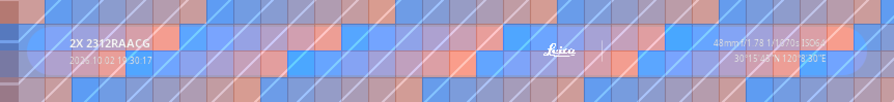
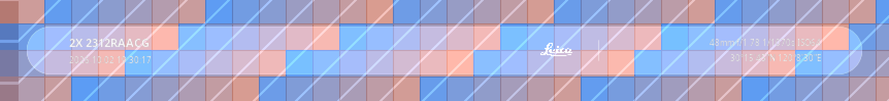
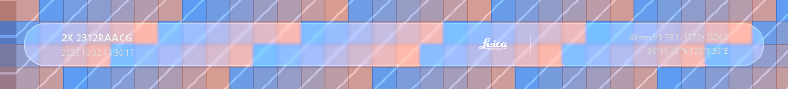
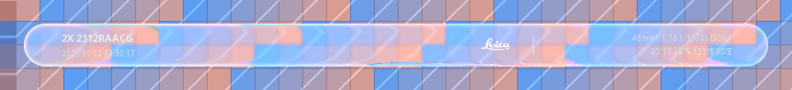

<p align="center">
  
</p>

<h1 align="center">LiquidFrame</h1>

[English](README.md)

LiquidFrame 是一个 LSPosed 模块，可替换小米相机支持路径中的照片水印，并绘制液态玻璃风格的胶囊。仓库还包含一个用于预览材质效果的独立示例应用。

本项目与小米、徕卡和 Apple 无关联，也未获得其认可。

## 功能

- 在支持的相机水印路径中替换原水印。
- 从当前拍摄记录读取设备、时间、曝光和定位信息；缺失字段会省略。
- 使用 CPU 像素渲染器绘制折射、色散、模糊和边缘效果。
- 提供 Compose 设置界面和材质示例应用。

## 效果预览

以下图片由 `docs/RenderSamples.kt` 离设备生成，并非实机拍摄结果。

| 原面板 | 磨砂 | 液态玻璃 |
| --- | --- | --- |
|  |  |  |



## 环境要求

**模块 `app/`**

- Android 8.0（API 26）及以上
- 小米相机，包名通常为 `com.android.camera` 或 `com.miui.camera`
- LSPosed 或兼容 Xposed API 82 的框架
- Root 权限

**示例应用 `gallery/`**

- Android 13（API 33）及以上
- 无需 Root 或 LSPosed

## 安装

1. 安装模块 APK。
2. 在 LSPosed 中启用 LiquidFrame，并将作用域设为设备上的小米相机。
3. 强行停止相机后重新打开，在模块设置中调整水印。
4. 拍摄测试照片，确认当前相机版本能够命中替换路径。

相机内部类名和处理流程会随版本变化，不能保证所有版本都兼容。若未生效，请先关闭模块并提供相机版本及模块日志。

## 构建

需要 JDK 21 和 Android SDK Platform 37。

```bash
./gradlew :app:assembleDebug :gallery:assembleDebug
```

APK 输出目录：

- `app/build/outputs/apk/`
- `gallery/build/outputs/apk/`

发布构建的签名配置见 [SIGNING_SETUP.md](SIGNING_SETUP.md)。

## 目录

- `app/`：LSPosed 模块、设置界面和 CPU 材质渲染器
- `gallery/`：材质示例应用及实时渲染组件
- `tools/`：相机 APK / DEX 分析和匹配器验证脚本
- `docs/`：离设备渲染示例

## 许可

项目采用 Apache License 2.0。第三方代码和资源的来源见 [NOTICE](NOTICE)。
